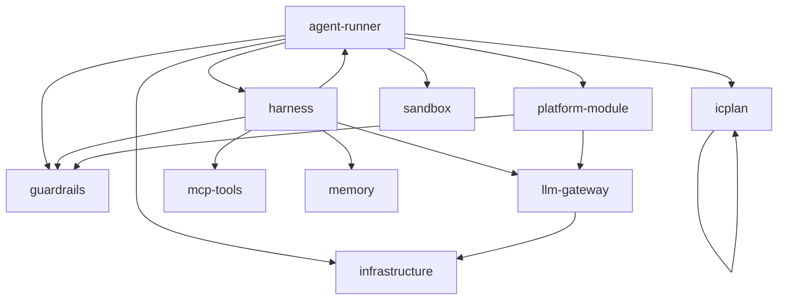

# Architecture Spine — Agent TaskTracker Max

> Перенесено из `agent-architecture`. Источник правды теперь YAML в `docs/architecture`.

## Design Paradigm

ICPlan хранит задачи и процесс. Agent Runner забирает запуск, готовит изолированную среду, Harness ведёт цикл агента, Guardrails проверяют действия, итог возвращается в задачу.

## Invariants & Rules

Стрелка значит «может обращаться». Связи взяты из реестра интеграций.

### AD-1 — Sandbox: тёплый пул + одноразовое использование, Docker за интерфейсом `SandboxProvider`

- **Binds:** all
- **Prevents:** отход реализации от решения «Sandbox: тёплый пул + одноразовое использование, Docker за интерфейсом `SandboxProvider`»
- **Rule:** Runner работает с интерфейсом `create / claim / exec / destroy`; первая реализация — Docker, следующая — K8s Pod. По каждому профилю держится пул из N запущенных sandbox; запуск забирает готовый, после запуска sandbox уничтожается, пул доливается (подход Copilot coding agent, E2B, Daytona). - Альтернативы: контейнер на запуск без пула (2–10 с старта), контейнер на агента (запуски видят друг друга), контейнер на задачу (ресурсы заняты в простое), microVM (сильнее изоляция, сложнее) — можно добавить как провайдера. - Ориентиры ресурсов: harness 150–300 МБ RAM, агент-разработчик 0.5–2 ГБ, CPU почти не нужен (ожидание LLM).

### AD-2 — Harness: LangGraph (Python) внутри sandbox — подтверждено

- **Binds:** all
- **Prevents:** отход реализации от решения «Harness: LangGraph (Python) внутри sandbox — подтверждено»
- **Rule:** Агентский цикл — граф LangGraph: `context → llm → tools → context`. Hooks (G2) реализуются как узлы/обёртки графа до и после `llm` и `tools`. LLM-клиент настроен на endpoint LiteLLM (OpenAI-совместимый API). - Альтернативы (R&D v3.1, 11.10.2026): OpenAI Agents SDK (запасной: пауза через `RunState`, сравнение прототипом в 1.3.9), PydanticAI, Google ADK, Microsoft Agent Framework, Claude Agent SDK (формат Anthropic, CLI в образе), Hermes Agent (готовый агент: заменил бы Runner, Sandbox, Memory, Guardrails), свой минимальный цикл (всё писать самим). - Почему LangGraph: `interrupt` для approve (G2), checkpoint на каждом шаге для возобновления (хранится у Runner в S5, Harness пишет через I12 — …

### AD-3 — Go для Runner, TypeScript для Platform module (в ICPlan), Python для Harness

- **Binds:** all
- **Prevents:** отход реализации от решения «Go для Runner, TypeScript для Platform module (в ICPlan), Python для Harness»
- **Rule:** Go — долгоживущий Runner, конкурентность, работа с Docker/K8s API. Platform module — модуль форка ICPlan на его стеке. Python — экосистема LLM (LangGraph, LiteLLM, MCP). - Граница: Runner ↔ Harness по gRPC или HTTP + поток событий; Harness — образ контейнера. - Альтернатива: всё на Python — проще, но слабее для Runner под нагрузкой.

### AD-4 — Хранилища

- **Binds:** all
- **Prevents:** отход реализации от решения «Хранилища»
- **Rule:** / Данные / Хранилище / /---/---/ / Определения агентов, версии, данные guardrails, профили / БД ICPlan (Postgres), Platform module — отдельная схема / / Запуски, статусы, события запуска / БД ICPlan / / M1 сессионная, M2 эпизодическая, M3 задачная, M5 процедурная / БД ICPlan / / M6 организационная / Документы ICPlan / / M4 семантическая (после MVP, вместе с RAG) / pgvector в Postgres ICPlan / / Логика guardrails (Rego) / git / Права и TTL памяти проверяет Memory Service, агенты не ходят в БД напрямую. - Пересмотрено: Qdrant заменён на pgvector — расширение уже установлено в Postgres ICPlan, меньше компонентов; отдельный движок — по данным нагрузки.

### AD-5 — LLM Gateway — LiteLLM Proxy

- **Binds:** all
- **Prevents:** отход реализации от решения «LLM Gateway — LiteLLM Proxy»
- **Rule:** Алиасы моделей, virtual keys на агента (лимиты, бюджеты), fallback; callbacks в Langfuse — после MVP. G4 — guardrail-хуки LiteLLM (PII-маскирование, модерация, детект injection).

### AD-6 — Guardrail Policy

- **Binds:** all
- **Prevents:** отход реализации от решения «Guardrail Policy»
- **Rule:** Движок решений G1 и G2 — OPA (Apache 2.0, CNCF): логика (Rego) в git с тестами `opa test`, данные (allowlist, лимиты) в БД ICPlan. Каждая точка G1–G4 включается и выключается в конфиге деплоя (`guardrails.gN.enabled`), режим отказа движка — `on_engine_error: deny / allow`. Точки применения: G1 — проверяет сам Runner; G2 — передаются в Harness при старте; G3 — транслируются в параметры контейнера и egress-прокси; G4 — в конфиг virtual key LiteLLM.

### AD-7 — Сеть и секреты (G3)

- **Binds:** all
- **Prevents:** отход реализации от решения «Сеть и секреты (G3)»
- **Rule:** Sandbox в изолированной сети; исходящий трафик только через egress-прокси с allowlist. Секреты подставляет прокси, в контейнер не передаются.

### AD-8 — Контракт ICPlan

- **Binds:** all
- **Prevents:** отход реализации от решения «Контракт ICPlan»
- **Rule:** Agent Runner работает как внешний раннер ICPlan: опрашивает очередь запусков по ключу агента и стримит результат обратно (протокол `@itsaplan/runner`). Прежний вариант `POST /runs` (push) заменён — см. `add-icplan-integration`.

### AD-9 — Хранение конфигурации

- **Binds:** all
- **Prevents:** отход реализации от решения «Хранение конфигурации»
- **Rule:** Источник правды — БД ICPlan; версии определений агента; экспорт/импорт YAML для ревью и переноса между окружениями. Наши настройки — Platform module в ICPlan. Альтернатива (Config Repo в git, проект AI-агент) отклонена: два источника правды и синхронизация с UI.

### AD-10 — MCP или прямой вызов

- **Binds:** all
- **Prevents:** отход реализации от решения «MCP или прямой вызов»
- **Rule:** Гибрид по правилам R1–R7: решает модель — тул; тул для нескольких агентов или с секретом — MCP; детерминированное, пакетное и внутреннее — прямой вызов; админ-функции — отдельные MCP по уровню доверия. Агент ходит к MCP-серверам только через MCP-прокси Runner (AD-19). / # / Правило / Как / /---/---/---/ / R1 / Последовательность известна заранее (детерминированно) / прямой вызов (REST / gRPC / SDK) / / R2 / Следующий шаг решает модель / тул агента / / R3 / Тул нужен нескольким агентам или держит секрет вне агента / MCP-сервер / / R4 / Тул один, стабильный, только внутри Harness / нативный тул Harness / / R5 / Пакетные и массовые операции / прямой вызов (MCP медленнее и дороже по токенам) / …

### AD-11 — Рабочие данные

- **Binds:** all
- **Prevents:** отход реализации от решения «Рабочие данные»
- **Rule:** Workspace эфемерный; код — ветка `agent/<KEY>` + PR; документы и артефакты — в задачу ICPlan (RustFS, S3 API); M2/M3 — БД. Доступ к репозиториям — allowlist агента и короткоживущий токен на запуск через прокси. Общая папка на хосте (проект AI-агент) отклонена: изоляция и масштабирование.

### AD-12 — Observability

- **Binds:** all
- **Prevents:** отход реализации от решения «Observability»
- **Rule:** MVP — таблица событий запуска в БД ICPlan → чат запуска в задаче. Langfuse — после MVP (тяжёлый self-host: Postgres + ClickHouse + Redis + S3). Prometheus / Grafana / Loki — в бэклоге.

### AD-13 — RAG

- **Binds:** all
- **Prevents:** отход реализации от решения «RAG»
- **Rule:** Не в MVP: документы — через `get_document`, код — агентный поиск. RAG (pgvector + локальный эмбеддер) — механизм чтения M4/M6, вводится по мере роста корпуса.

### AD-14 — Очередь и планирование запусков

- **Binds:** all
- **Prevents:** отход реализации от решения «Очередь и планирование запусков»
- **Rule:** Альтернативы (R&D v3.1, 11.10.2026): Hatchet (ключи параллельности CEL — вторая очередь и новый сервис), River Pro (лимиты по аргументам — платно), Temporal (кластер), Kueue (квоты ресурсов — на этапе 4, лимит модели остаётся у нас). Очередь запусков — в ICPlan; Agent Runner забирает запуски и решает, когда стартовать, планировщиком со слотами (вариант B): запуск стартует, только когда свободны все его слоты — глобальный (`global_max`), агента (`parallel`, `max`), модели (`models.<alias>.max`), задачи (`per_issue: 1`). Режим `scheduling.mode: sequential / parallel` переключает всю платформу. Порядок `fifo / priority`. Несколько экземпляров Runner делят слоты через блокировку в Postgres. …

### AD-15 — Развёртывание и инфраструктура

- **Binds:** all
- **Prevents:** отход реализации от решения «Развёртывание и инфраструктура»
- **Rule:** k3s на одном узле; namespaces `itsaplan-core`, `itsaplan-data`, `itsaplan-agents`, `itsaplan-platform`; Helm-чарты с `existingSecret`; Traefik (в k3s) — ingress и TLS, админки без ingress; Service — балансировка по репликам; PostgreSQL 17 + pgvector под CloudNativePG с пулером PgBouncer (transaction); RustFS (S3) для вложений и копий; бэкап вне узла; NetworkPolicy по списку интерфейсов. Локально — compose (этапы 1–2) и k3d. Отклонены: ingress-nginx и MinIO (архивированы). R&D: Kubernetes, ingress, СУБД.

### AD-16 — Профиль нагрузки

- **Binds:** all
- **Prevents:** отход реализации от решения «Профиль нагрузки»
- **Rule:** Базовые гипотезы: 15 одновременных пользователей, ~20 RPS на API ICPlan (p95 < 300 мс), до 6 запусков в очереди и 4 активных, ~1 RPS и ~55 тыс. токенов/мин к LiteLLM; узел 8 vCPU / 32 ГБ / 400 ГБ. Подтверждаются нагрузочным тестом (задача 4.8). R&D: профиль нагрузки.

### AD-17 — Управление ходом задачи пользователем и агентом

- **Binds:** FR-10, FR-11, FR-12, FR-28, FR-152, FR-197, FR-199, FR-200, FR-201, FR-202, FR-203
- **Prevents:** отход реализации от решения «Управление ходом задачи пользователем и агентом»
- **Rule:** Закрыты открытые вопросы историй ICPlan (проверено по коду ICPlan и аналогам, R&D потоков): / Вопрос / Решение / Основание / /---/---/---/ / Вердикт по результату / «принято» → переход при успехе; «не выполнено» с обязательной заметкой → новый запуск того же шага, учёт в лимите шага (FR-200) / Copilot: итерация комментариями на той же работе / / Проверка со мной / настройка шага `require_review` и флаг задачи `review_with_me`; задача ждёт вердикта, без ответа — напоминания (FR-199) / Jira + Rovo: ревью перед передачей; Devin: двигает человек / / Остановка процесса / флаг `process_paused`: отмена запуска, шаги не срабатывают, ручные переводы разрешены (FR-201); отмену Runner узнаёт по ответу …

### AD-18 — Закрытие открытых вопросов спек

- **Binds:** all
- **Prevents:** отход реализации от решения «Закрытие открытых вопросов спек»
- **Rule:** Все открытые вопросы (❓ и 📌) решены агентом по коду ICPlan, документации и R&D; решения 📌 вынесены владельцу продукта на подтверждение (`approvals.md`, роль «Владелец продукта»). / Вопрос / Решение / Основание / /---/---/---/ / AGPL-3.0 доработок ICPlan / доработки форка ICPlan, включая Platform module (модуль внутри форка, AD-3), публикуются в открытом репозитории форка; сервисы платформы (Agent Runner, Harness, Memory API, конфигурация и образы sandbox) — отдельные программы, связь с ICPlan только по сети и API, **код закрыт** (решение владельца продукта 11.10.2026) / лицензия ICPlan распространяется на форк, но не на отдельные программы, общающиеся по сети / / Доступ Harness к checkpoint …

### AD-19 — Проверка тулов вне sandbox и зависимости проекта

- **Binds:** all
- **Prevents:** отход реализации от решения «Проверка тулов вне sandbox и зависимости проекта»
- **Rule:** Закрывает вопросы Q-MCP-01 и Q-SBX-01 по исследованию (R&D MCP, R&D рабочего пространства). / Вопрос / Решение / Почему / /---/---/---/ / Где проверять allowlist тулов и G2 для MCP / **MCP-прокси Agent Runner**: Harness ходит к MCP только через Runner (`/runs/:id/mcp/:server`, I9); Runner фильтрует `tools/list` и проверяет `tools/call` по allowlist манифеста запуска, вызывает G2 в OPA (I10) и подставляет учётные данные сервера из Secret. Sandbox к MCP-серверам напрямую не ходит; egress-прокси ключ агента к MCP не подставляет / проверка вне недоверенной среды; у Runner уже есть манифест, токен запуска, подтверждения и клиент OPA; нового сервиса нет; MCP ~1 RPS; официальный MCP SDK для Go …

### AD-20 — Контракт шага: данные, память, критерии приёмки

- **Binds:** all
- **Prevents:** отход реализации от решения «Контракт шага: данные, память, критерии приёмки»
- **Rule:** Решено по исследованию (R&D контракта шага) по поручению владельца продукта 11.10.2026. / Вопрос / Решение / Почему / /---/---/---/ / Что шаг получает и отдаёт / вход: задание, критерии с происхождением, передача предыдущего шага (M3: сделано, дальше, ссылки на артефакты, вопросы, предложенные критерии), M2; выход: итог, артефакты в своей подпапке, передача. Не передаются: M0, промпты, вывод тулов — они в событиях запуска / ссылки вместо содержимого (Anthropic), фильтр передачи (OpenAI Agents SDK) / / Кто задаёт критерии / процесс («результат шага», «готовность шага»), человек (чек-лист задачи), предыдущий агент (предлагает в передаче), ревьюер (добавляет при возврате); порядок при …

### AD-21 — Чат запуска в задаче на протоколе AG-UI

- **Binds:** all
- **Prevents:** отход реализации от решения «Чат запуска в задаче на протоколе AG-UI»
- **Rule:** Решено по исследованию (R&D вида работы агента) по замечанию владельца продукта 11.10.2026. / Вопрос / Решение / Почему / /---/---/---/ / Что видит пользователь / панель «Агент» в задаче: реплики агента о намерении, свёрнутые рассуждения модели (если провайдер отдаёт), шаги цикла и вызовы тулов, план «сделано / дальше», вопросы и подтверждения с кнопками, указания пользователя, карточка итога (критерии ✓ / ✗, артефакты, токены, вердикт шага); все запуски задачи — одна лента по шагам процесса / замечание владельца; Linear (thought, elicitation, response), журнал сессии Copilot / / Формат событий / события AG-UI (`RUN_*`, `STEP_*`, `TEXT_MESSAGE_*`, `REASONING_*`, `TOOL_CALL_*`, …

### AD-22 — Базы, схемы и роли БД сервисов

- **Binds:** all
- **Prevents:** отход реализации от решения «Базы, схемы и роли БД сервисов»
- **Rule:** Решено по исследованию (R&D: базы, схемы и роли), уточняет AD-4 и AD-18. / Схема / База / Владелец (роль БД) / Что хранит / /---/---/---/---/ / `public` / `itsaplan` / api ICPlan (`itsaplan`) / таблицы форка, процесс задачи / / `platform` / `itsaplan` / api ICPlan (`itsaplan`): Platform module, Observability / настройки агентов, профили, доступы, события запуска / / `runner`, `harness_ckpt` / `itsaplan` / Agent Runner (`runner`) / слоты, кэш подготовки, checkpoint цикла / / `memory` / `itsaplan` / Memory API (`memory`) / M3, позже M4 / / `public` / `litellm` / LiteLLM (`litellm`) / ключи, бюджеты, журнал затрат / Роль сервиса — владелец своей схемы и своих миграций; чужие таблицы — только …

### AD-23 — Определение агента для запуска — через API Platform module

- **Binds:** FR-54, FR-55, FR-56, FR-97, FR-99
- **Prevents:** отход реализации от решения «Определение агента для запуска — через API Platform module»
- **Rule:** Решено по исследованию (R&D: откуда Agent Runner берёт определение агента), закрывает Z-ICP-3. / Вопрос / Решение / Почему / /---/---/---/ / Через какой стык Runner получает определение / I4: `GET /platform/runs/:runId/agent` → `{version, definition: AgentDefinition, settings: AgentSettings}`; определение в формате `agent/v1` экспорта (FR-56). Claim форка (I1) не меняется / Platform module уже владеет единой версией и снимком (`agent_settings_version`) и читает таблицы Registry той же ролью `itsaplan` (AD-3, AD-22); код форка вне нашего модуля не меняется (AD-18) / / Как закрепляется версия / версию задаёт задача (FR-55) или Platform module при первом вызове пишет её в …

### AD-24 — Экраны настроек Platform module

- **Binds:** FR-54
- **Prevents:** отход реализации от решения «Экраны настроек Platform module»
- **Rule:** Решено по исследованию (R&D: где администратор задаёт настройки Platform module), закрывает ОВ-control-plane-1 и Z-ICP-19. / Уровень / Экран ICPlan / Права / Эндпоинты Platform module (I20) / /---/---/---/---/ / агент / карточка агента → раздел «Платформа» / ресурс `ai_agents` форка (чтение и `edit`) / `/platform/agents/:agentId/settings`, история и откат версий, экспорт и импорт, kill switch `agent:<id>` / / проект / Проект → ИИ-команда → «Платформа» / ресурс `ai_agents` форка в разделе проекта / `/platform/projects/:projectKey/guidance`, `/budget`, `/access`, ресурсы проекта и шаг подготовки / / экземпляр / God mode → «Платформа», через точку расширения `@/cloud` / владелец экземпляра / …

### AD-25 — Срок хранения запусков, переписки и истории задачи

- **Binds:** FR-43
- **Prevents:** отход реализации от решения «Срок хранения запусков, переписки и истории задачи»
- **Rule:** Решено по исследованию (R&D: срок хранения в таблицах форка), закрывает ОВ-icplan-integration-1 и Z-ICP-16; уточняет FR-43. / Данные / Срок / Кто удаляет / /---/---/---/ / M1, M2 в таблицах форка (`agent_chat_message`, `agent_run`, `issue_activity`) для памяти / `retention` профиля памяти — фильтр чтения Memory API: старше срока не отдаются / никто: Memory только читает (`SELECT`) / / `agent_run` (завершённые, по `finished_at`) / `runs.retention_days` ≥ 365 (верхняя граница M2 и `retention_days` событий) / ICPlan, задача worker форка; запуски, у которых ещё есть `run_event`, пропускаются / / `agent_chat_thread` (тред целиком по `updated_at`) → сообщения и события каскадом / …

### AD-26 — Уточнения по замечаниям ролей ICPlan (без отдельного R&D — по фактам кода форка и решениям AD-9, AD-20, AD-23)

- **Binds:** FR-136
- **Prevents:** отход реализации от решения «Уточнения по замечаниям ролей ICPlan (без отдельного R&D — по фактам кода форка и решениям AD-9, AD-20, AD-23)»
- **Rule:** / Вопрос / Решение / Основание / /---/---/---/ / Формат навыка (ОВ-agent-registry-1) / Anthropic Agent Skill: `SKILL.md` с frontmatter `name`, `description`, справочные файлы, без исполняемых скриптов / так в форке: `apps/api/src/modules/agents/skills/skill-format.ts` / / Каталог для валидатора определения (ОВ-agent-registry-3) / офлайн-валидатор (задача 1.2) проверяет схему `agent/v1` и внутренние ссылки файла; ссылки на ресурсы (навыки, тулы, MCP, профили) проверяет импорт Platform module `POST /platform/agents/import` по БД / один источник каталога — БД (AD-9) / / Где YAML дополнений до Platform module (ОВ-agent-registry-4) / отдельного файла нет: дополнения — настройки Platform module …

### AD-27 — Цепочки агентов: граф процесса, возвраты с причинами, лимиты, бюджет задачи, обучение через предложения

- **Binds:** FR-45, FR-120, FR-152, FR-205
- **Prevents:** отход реализации от решения «Цепочки агентов: граф процесса, возвраты с причинами, лимиты, бюджет задачи, обучение через предложения»
- **Rule:** Решено по исследованию (R&D: цепочка агентов в трекере, Э9), решение принято 14.10.2026 по результату анализа (выбор поручен агенту владельцем продукта). / Вопрос / Решение / Альтернативы и почему не они / Сила опоры / /---/---/---/---/ / Маршрут / детерминированный граф процесса трекера (AD-17), роли в шагах произвольные; агент маршрут не выбирает, меняет колонку только ICPlan; режим «супервизор» — не основной / супервизор выбирает исполнителя сам: усиление ошибок (Google 2512.08296), ответственность размыта / сильная для проблемы, средняя для выбора / / Возвраты / `ProcessStep.transitions[{reason, to}]`; исход шага агент выбирает только из разрешённых переходов (`RunResult.outcome`, …

### AD-28 — Самообучение агентов: модульный контур с режимами, ограничениями и снимками

- **Binds:** FR-46, FR-47, FR-64, FR-65, FR-103, FR-104, FR-131, FR-153
- **Prevents:** отход реализации от решения «Самообучение агентов: модульный контур с режимами, ограничениями и снимками»
- **Rule:** Решено по исследованию (R&D: цепочка агентов в трекере, Э7–Э9), решение принято 14.10.2026 по результату анализа (выбор поручен агенту владельцем продукта, как в AD-27). Контекст: AD-27 разрешил агенту только предлагать изменения; владелец запросил самообучение с отключаемостью, настройками, снимками и откатом. Уточняет AD-27: режим «применять с гейтами» добавляется как явная настройка, по умолчанию «выкл». / Вопрос / Решение / Альтернативы и почему не они / Сила опоры / /---/---/---/---/ / Сценарии качества (Decision Drivers) / С1 отключаемость (≤ 1 мин, потерь 0), С2 настраиваемость (без деплоя, хардкода 0), С3 откат на снимок (≤ 5 мин), С4 заменяемость движка памяти (правок ядра 0), С5 …

## Consistency Conventions

| Concern | Convention |
| --- | --- |
| Именование | Имена полей: JSON наших контрактов — camelCase, как в API ICPlan (OpenAPI 1.3.0: `issueId`, `systemPrompt`, `inputTokens`, `lastError`); задача — парой `issueId` (ключ БД) и `issueIdentifier` (`MKT-42`), как в форке; единица измерения — суффиксом (`readyMs`, `memoryMb`, `costUsd`, `ttlSec`, как … |

## Stack

| Name | Version |
| --- | --- |
| It's a Plan (наш форк) | upstream v1.4.0 |
| Bun | 1.4.x |
| Elysia | 1.4.x |
| Next.js | 16.x |
| Drizzle ORM | 0.45.x |
| Go | 1.2x |
| Python | 3.12+ |
| Node.js | 24 (образ `node:24-alpine`) |
| FastAPI | 0.11x |
| uv | 0.x |
| LangGraph | 1.2.14 (закреплена, AD-18) |
| LangChain MCP (`langchain.mcp`) | langchain 1.4.4, extra `mcp` (fastmcp ≥ 4.0.11) |
| MCP Python SDK | v2.3.0 |
| ContextForge (IBM) | v1.0.11 |
| agentgateway | v1.6.0 |
| langchain-mcp-adapters | 0.3.2 |
| LiteLLM Proxy | v1.104.2 (закреплена, AD-18) |
| Open Policy Agent | v1.21.1 |
| LlamaFirewall (PurpleLlama) | — |
| Langfuse | v4.56.0 |
| Phoenix (Arize) | — |
| Opik (Comet) | 2.2.96 |
| text-embeddings-inference | закреплена cpu-1.9.4 |
| Bifrost | — |
| TensorZero | 2026.6.0 |
| PostgreSQL | 17 |
| Mem0 | ts-v3.3.1 |
| LangMem | — |
| Graphiti (Zep) | v0.30.2 |
| pgvector | — |
| DSPy + GEPA | — |
| CloudNativePG | v1.30.1 |
| PgBouncer | 1.26.0 |
| RustFS | 1.0.x |
| SeaweedFS | 4.48 |
| MinIO | 2025-10-15 |
| k3s | v1.37.1+k3s1 |
| k3d | v5.9.0 |
| RKE2 | v1.37.1+rke2r1 |
| Talos | v1.14.2 |
| Kueue | v0.20.1 |
| Helm | v4.3.0 |
| Traefik | v3.7 (в составе k3s) |
| ingress-nginx | controller-v1.15.1 |
| Gateway API | v1.6.3 |
| Docker Engine (Moby) | 29.x |
| Squid | образ `ubuntu/squid` 6.x (upstream 7.7) |
| gVisor (runsc) | release-20261005.0 |
| kubernetes-sigs/agent-sandbox | v1.0.6 |
| Daytona | v0.190.0 |
| Firecracker | v1.17.0 |
| k6 | v2.3.0 |
| Prometheus | v3.15.0 |
| Grafana | v13.2.3 |
| Loki | v3.7.8 |
| Gitea | v28.1.0 |
| Argo CD | v3.5.4 |
| Sealed Secrets | v0.40.0 |
| Trivy | v0.75.0 |
| Syft | 1.x |
| distroless | `static:nonroot` |
| GitHub Container Registry | — |
| OpenSpec | v1.14.1 |
| MkDocs | 1.6.1 |
| Material for MkDocs | 9.7.7 |

## Structural Seed

Контейнеры и хранилища описаны в модели системы, см. `docs/architecture`.

## Capability → Architecture Map

| Capability / Area | Lives in | Governed by |
| --- | --- | --- |
| FR-1, FR-2, FR-3, FR-4, FR-5, FR-6, FR-7, FR-8, FR-9, FR-10, FR-11, FR-12, FR-13, FR-14, FR-15, FR-16, FR-17, FR-18, NFR-1 | `icplan` | см. решения AD |
| FR-19, FR-20, FR-21, FR-22, FR-23, FR-24, FR-25, FR-26, FR-27, FR-28, FR-29, FR-30, FR-31, FR-32, FR-33, FR-34, FR-35, NFR-2 | `harness` | см. решения AD |
| FR-36, FR-37, FR-38, FR-39, FR-40, FR-41, FR-42, FR-43, FR-44, FR-45, FR-46, FR-47, FR-48, FR-49, FR-50, FR-51, FR-52, NFR-3 | `memory` | см. решения AD |
| FR-53, FR-54, FR-55, FR-56, FR-57, FR-58, FR-59, FR-60, FR-61, FR-62, FR-63, FR-64, FR-65, NFR-4 | `platform-module` | см. решения AD |
| FR-66, FR-67, FR-68, FR-69, FR-70, FR-71, FR-72, FR-73, FR-74, FR-75, FR-76, FR-77, FR-78, FR-79, FR-80, FR-81, NFR-5 | `agent-runner` | см. решения AD |
| FR-82, FR-83, FR-84, FR-85, FR-86, FR-87, FR-88, FR-89, FR-90, FR-91, FR-92, FR-93, FR-94, NFR-6 | `sandbox` | см. решения AD |
| FR-95, FR-96, FR-97, FR-98, FR-99, FR-100, FR-101, FR-102, FR-103, FR-104, FR-105, FR-106, FR-107, FR-108, FR-109, NFR-7 | `platform-module` | см. решения AD |
| FR-110, FR-111, FR-112, FR-113, FR-114, FR-115, FR-116, FR-117, FR-118, FR-119, FR-120, FR-121, FR-122, FR-123, FR-124, FR-125, FR-126, FR-127, FR-128, FR-129, FR-130, FR-131, FR-132, FR-133, NFR-8 | `guardrails` | см. решения AD |
| FR-134, FR-135, FR-136, FR-137, FR-138, FR-139, FR-140, FR-141, FR-142, FR-143, FR-144, FR-145, NFR-9 | `llm-gateway` | см. решения AD |
| FR-146, FR-147, FR-148, FR-149, FR-150, FR-151, FR-152, FR-153, FR-154, FR-155, FR-156, FR-157, FR-158, NFR-10 | `observability` | см. решения AD |
| FR-159, FR-160, FR-161, FR-162, FR-163, FR-164, FR-165, FR-166, FR-167, FR-168, FR-169, FR-170, FR-171, FR-172, FR-173, FR-174, FR-175, NFR-11, NFR-12 | `infrastructure` | см. решения AD |
| FR-176, FR-177, FR-178, FR-179, FR-180, FR-181, FR-182, FR-183, FR-184, FR-185, FR-186, FR-187, NFR-13 | `mcp-tools` | см. решения AD |
| FR-188, FR-189, FR-190, FR-191, FR-192, FR-193, FR-194, FR-195, FR-196, FR-197, FR-198, FR-199, FR-200, FR-201, FR-202, FR-203, FR-204, FR-205, FR-206, FR-207, FR-208, FR-209, FR-210, FR-211, FR-212, NFR-14 | `icplan` | см. решения AD |

## Deferred

- Планирование и выбор агента (это ICPlan).
- Прямое взаимодействие агентов друг с другом.
- UI в первой итерации (сначала API + CLI).
