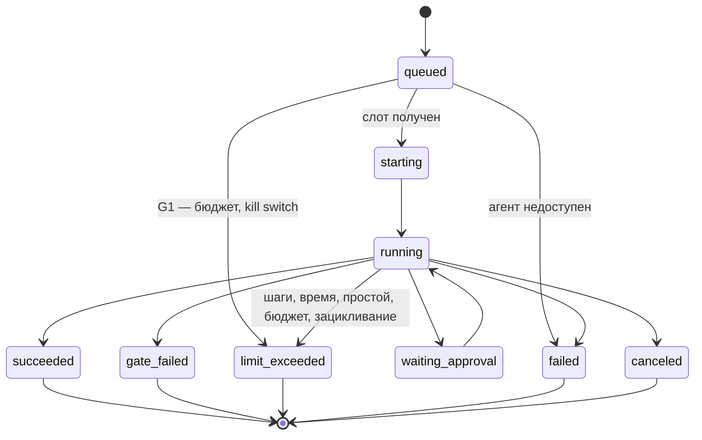

Порядок работы компонента: что за чем происходит внутри и с соседями (источник — `docs/how/agent-runner.md`, на сайте — вкладка «Архитектура» компонента). Поля данных — в контрактах на вкладке «Интеграции» компонента, таблицы — на вкладке «Данные», стороны и протоколы — в карточках «Интеграций», сквозной сценарий — в [архитектуре](..\..\..\..\source\architecture.md).

### Порядок работы и сценарии

#### Порядок работы

| # | Поток | Участники | Данные | I | Сценарий |
|---|---|---|---|---|---|
| 1 | Опрос очереди | Agent Runner → ICPlan | `Run` | I1 | С1 |
| 2 | Планирование: свободны ли слоты (глобальный, агента, модели, задачи) | Agent Runner → таблица слотов | `queued` → `admitted` | — | С1 |
| 3 | Допуск и бюджет (G1) | Agent Runner → Guardrails | `PolicyInput` → `PolicyDecision` | I5 | С1 |
| 4 | Определение и настройки версии запуска, после слотов; версия закрепляется в запуске (AD-23) | Agent Runner → Platform module | `AgentDefinition`, `AgentSettings` | I4 | С1 |
| 5 | Контейнер из тёплого пула | Agent Runner → Sandbox | `SandboxClaim` | I6 | С1 |
| 6 | Токен репозиториев на запуск | Agent Runner → git-провайдер | `RepoGrant` | I18 | — |
| 7 | Задание для Harness | Agent Runner → Harness | `RunBundle` | I7 | С1 |
| 8 | События шагов | Harness → Agent Runner → ICPlan | `RunEvent` | I7, I2 | С1 |
| 9 | Решение по паузе | ICPlan → Agent Runner → Harness | `ApprovalDecision` | I3, I7 | — |
| 10 | Итог | Harness → Agent Runner → ICPlan | `RunResult` | I7, I2 | С1 |
| 11 | Таймаут или отмена | Agent Runner → Harness | сигнал остановки | I7 | — |
| 12 | Уничтожение контейнера, долив пула | Agent Runner → Sandbox | `sandboxId` | I6 | С1 |

#### С1. Запуск от очереди до итога

{{seq:seq-agent-runner-1}}

### Состояния запуска

Единый список статусов запуска — требование FR-72; остальные документы ссылаются на него.

| Причина завершения Harness (FR-27) | Статус запуска (FR-72) | Статус в ICPlan (`agent_run`) |
|---|---|---|
| `done` | `succeeded` | `success` |
| `gate_failed` | `gate_failed` | `failed` с пометкой «не прошёл проверку» |
| `limit` (шаги, время, простой, `loop_detected`) | `limit_exceeded` | `failed` с причиной |
| `error` | `failed` | `failed` |
| остановка пользователем | `canceled` | `canceled` |
