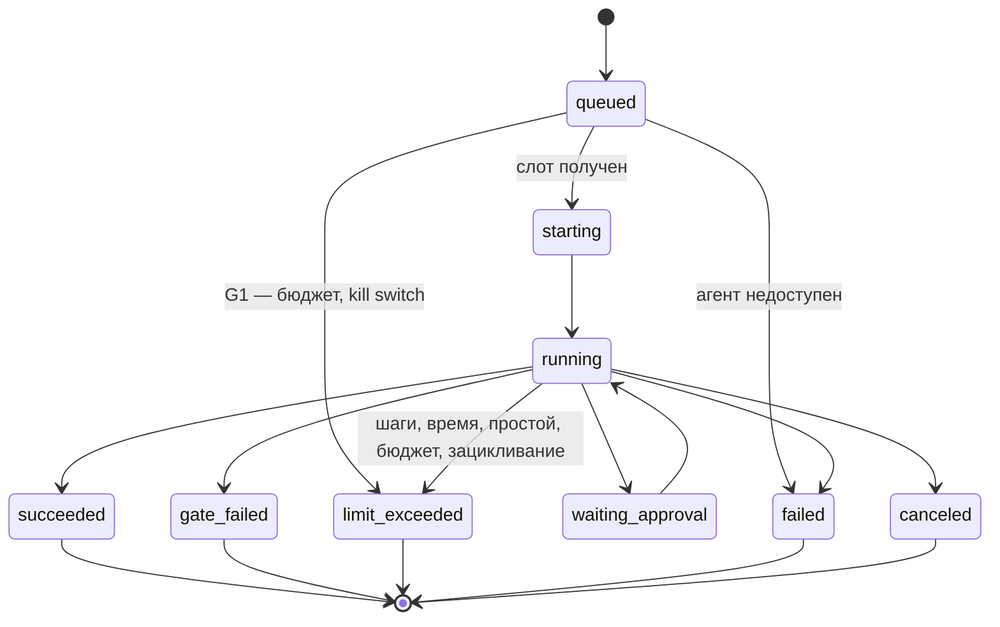

Порядок работы компонента: что за чем происходит внутри и с соседями (источник — `docs/how/agent-runner.md`, на сайте — вкладка «Архитектура» компонента). Поля данных — в контрактах на вкладке «Интеграции» компонента, таблицы — на вкладке «Данные», стороны и протоколы — в карточках «Интеграций», сквозной сценарий — в [архитектуре](..\..\..\..\source\architecture.md).

### Порядок работы и сценарии

#### Порядок работы

| # | Поток | Участники | Данные | I | Сценарий |
|---|---|---|---|---|---|
| 1 | Опрос очереди | [Agent Runner](../README.md) → [ICPlan](../../icplan/README.md) | [`Run`](../../../data/model-Run.yaml) | [I1](../integrations/I1.yaml) | С1 |
| 2 | Планирование: свободны ли слоты (глобальный, агента, модели, задачи) | [Agent Runner](../README.md) → таблица слотов | `queued` → `admitted` | — | С1 |
| 3 | Допуск и бюджет (G1) | [Agent Runner](../README.md) → [Guardrails](../../guardrails/README.md) | [`PolicyInput`](../../../data/model-PolicyInput.yaml) → [`PolicyDecision`](../../../data/model-PolicyDecision.yaml) | [I5](../integrations/I5.yaml) | С1 |
| 4 | Определение и настройки версии запуска, после слотов; версия закрепляется в запуске ([AD-23](../../../decisions/AD-23.yaml)) | [Agent Runner](../README.md) → [Platform module](../../platform-module/README.md) | [`AgentDefinition`](../../../data/model-AgentDefinition.yaml), [`AgentSettings`](../../../data/model-AgentSettings.yaml) | [I4](../integrations/I4.yaml) | С1 |
| 5 | Контейнер из тёплого пула | [Agent Runner](../README.md) → [Sandbox](../../sandbox/README.md) | [`SandboxClaim`](../../../data/model-SandboxClaim.yaml) | [I6](../integrations/I6.yaml) | С1 |
| 6 | Токен репозиториев на запуск | [Agent Runner](../README.md) → git-провайдер | [`RepoGrant`](../../../data/model-RepoGrant.yaml) | [I18](../integrations/I18.yaml) | — |
| 7 | Задание для [Harness](../../harness/README.md) | [Agent Runner](../README.md) → [Harness](../../harness/README.md) | [`RunBundle`](../../../data/model-RunBundle.yaml) | [I7](../integrations/I7.yaml) | С1 |
| 8 | События шагов | [Harness](../../harness/README.md) → [Agent Runner](../README.md) → [ICPlan](../../icplan/README.md) | [`RunEvent`](../../../data/model-RunEvent.yaml) | [I7](../integrations/I7.yaml), [I2](../integrations/I2.yaml) | С1 |
| 9 | Решение по паузе | [ICPlan](../../icplan/README.md) → [Agent Runner](../README.md) → [Harness](../../harness/README.md) | [`ApprovalDecision`](../../../data/model-ApprovalDecision.yaml) | [I3](../integrations/I3.yaml), [I7](../integrations/I7.yaml) | — |
| 10 | Итог | [Harness](../../harness/README.md) → [Agent Runner](../README.md) → [ICPlan](../../icplan/README.md) | [`RunResult`](../../../data/model-RunResult.yaml) | [I7](../integrations/I7.yaml), [I2](../integrations/I2.yaml) | С1 |
| 11 | Таймаут или отмена | [Agent Runner](../README.md) → [Harness](../../harness/README.md) | сигнал остановки | [I7](../integrations/I7.yaml) | — |
| 12 | Уничтожение контейнера, долив пула | [Agent Runner](../README.md) → [Sandbox](../../sandbox/README.md) | `sandboxId` | [I6](../integrations/I6.yaml) | С1 |

#### С1. Запуск от очереди до итога

{{seq:seq-agent-runner-1}}

### Состояния запуска

Единый список статусов запуска — требование [FR-72](../prd.md); остальные документы ссылаются на него.

| Причина завершения [Harness](../../harness/README.md) ([FR-27](../../harness/prd.md)) | Статус запуска ([FR-72](../prd.md)) | Статус в [ICPlan](../../icplan/README.md) (`agent_run`) |
|---|---|---|
| `done` | `succeeded` | `success` |
| `gate_failed` | `gate_failed` | `failed` с пометкой «не прошёл проверку» |
| `limit` (шаги, время, простой, `loop_detected`) | `limit_exceeded` | `failed` с причиной |
| `error` | `failed` | `failed` |
| остановка пользователем | `canceled` | `canceled` |
