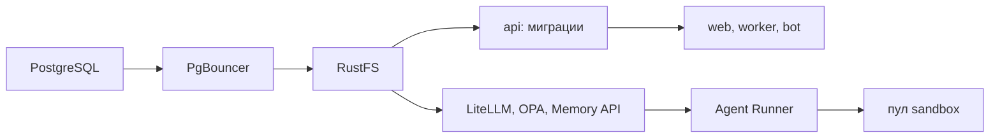

Порядок работы компонента: что за чем происходит внутри и с соседями (источник — `docs/how/infrastructure.md`, на сайте — вкладка «Архитектура» компонента). Поля данных — в контрактах на вкладке «Интеграции» компонента, таблицы — на вкладке «Данные», стороны и протоколы — в карточках «Интеграций», сквозной сценарий — в [архитектуре](..\..\..\..\source\architecture.md).

### Порядок работы и сценарии

#### Порядок работы

| # | Поток | Участники | Данные | I | Сценарий |
|---|---|---|---|---|---|
| 1 | Вход пользователя | Браузер → Traefik → `web` / `api` | HTML / JSON | [I21](../../../integrations/I21.yaml) | С1 |
| 2 | MCP агентов | MCP-прокси [Agent Runner](../../agent-runner/README.md) → `api /mcp` | JSON-RPC | [I24](../../agent-runner/integrations/I24.yaml) | — |
| 3 | Запросы к БД | сервисы → PgBouncer → PostgreSQL | SQL | [I22](../../../integrations/I22.yaml) | С1 |
| 4 | Вложения и артефакты | [Agent Runner](../../agent-runner/README.md), [ICPlan](../../icplan/README.md) → RustFS | файлы | [I19](../../agent-runner/integrations/I19.yaml) | С1 |
| 5 | Резервные копии | CloudNativePG → S3 вне узла | базовые копии + WAL | — | — |
| 6 | Создание запусков (этап 4) | [Agent Runner](../../agent-runner/README.md) → Kubernetes API | манифест Pod | [I23](../../agent-runner/integrations/I23.yaml) | — |
| 7 | Развёртывание | Администратор → Helm → Kubernetes API | чарты, values, Secret | — | — |

#### С1. Запрос пользователя к ICPlan

{{seq:seq-infrastructure-1}}

### Порядок запуска

