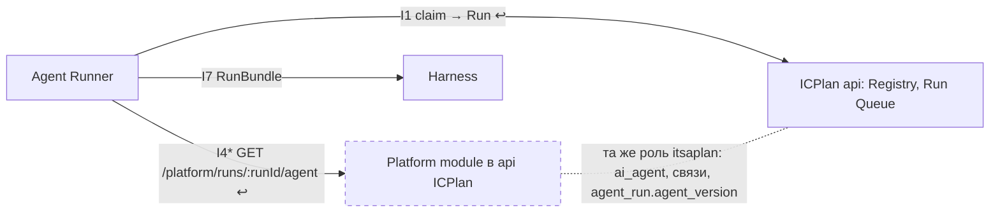

# R&D: Откуда Agent Runner берёт определение агента

← [Все R&D](README.md) · методология R&D v3.1 · компонент: **[Agent Runner](../architecture/components/agent-runner/README.md), [ICPlan](../architecture/components/icplan/README.md) (Registry), [Platform module](../architecture/components/platform-module/README.md)** · решение: [design AD-23](..\source\design\define-agent-platform\design.md) · замечание: [Z-ICP-3](..\architecture\components\icplan\docs\findings.md)

<div class="rnd-hero" markdown>
<div class="rnd-q">Вопрос</div>
Чтобы собрать задание [Harness](../architecture/components/harness/README.md) (`RunBundle.agent`), Runner нужны модель, инструкция, навыки, тулы, MCP и версия агента. `POST /agent-runs/claim` форка отдаёт только запуск (`prompt`, `systemPrompt`), наши настройки ([I4](../architecture/components/agent-runner/integrations/I4.yaml)) — без модели, навыков и MCP. Откуда Runner берёт определение агента и какой версии?

<div class="rnd-a">Ответ: у [Platform module](../architecture/components/platform-module/README.md) одним вызовом `GET /platform/runs/:runId/agent` ([I4](../architecture/components/agent-runner/integrations/I4.yaml), сервисный токен): определение `agent/v1` и настройки одной версии. [Platform module](../architecture/components/platform-module/README.md) работает внутри api [ICPlan](../architecture/components/icplan/README.md) и читает таблицы Registry сам. Версия запуска закрепляется в `agent_run.agent_version` при первом вызове. Claim форка не меняется.</div>

<span class="rnd-badge adopt">Adopt</span> определение через API [Platform module](../architecture/components/platform-module/README.md) · 0 $ · данные 12.10.2026
</div>

```deck
# Покрытие потребностей П1–П6
> только вариант через Platform module закрывает версию и снимок одной версии без правки claim
stack C. API Platform module: 4 ok, 2 part, 0 no
stack A. Снимок в ответе claim: 2 ok, 3 part, 1 no
stack B. Эндпоинт ICPlan по ключу агента: 2 ok, 3 part, 1 no
stack 0. Как сейчас (claim + I4): 3 ok, 1 part, 2 no
# Объём доработки
> выбранный вариант — одна подзадача минимального Platform module на этапе 2; claim форка не меняется
bar Определение через Platform module: 6/6 2.3.7 — 6 ч (I4, сервисный токен, версия запуска) ok
# Позиции ролей
side API Platform module | Снимок в claim
pos Архитектор: -2 | версией и снимком уже владеет Platform module
pos Разработчик Runner (оппонент): 1 | один ответ claim; согласен, если I4 отдаёт всё одним ответом
pos Сопровождающий форка: -2 | модуль `runner` форка не трогаем
pos Безопасность: -1 | только по своему запуску, без секретов
pos DevOps: -1 | сервисный токен уже есть; модуль нужен в 2.3
# Что меняется
> AD-23; новый эндпоинт I4; Platform module частично переезжает в задачу 2.3
stack Документы: 12 ok, 0 part, 0 mute
```

<div class="rnd-grid" markdown>
<div class="take" markdown>
**Берём**

- один вызов [Platform module](../architecture/components/platform-module/README.md) при старте запуска: `{version, definition: AgentDefinition, settings: AgentSettings}`;
- формат `agent/v1` экспорта ([FR-56](../architecture/components/platform-module/prd.md)) — один сериализатор для экспорта и запуска;
- закрепление версии в `agent_run.agent_version` ([FR-55](../architecture/components/platform-module/prd.md)): повторная выдача запуска получает ту же версию.
</div>
<div class="adapt" markdown>
**Адаптируем**

- [I4](../architecture/components/agent-runner/integrations/I4.yaml): к настройкам (`/platform/agents/:agentId/settings`) добавляется определение версии запуска (`/platform/runs/:runId/agent`);
- слоты планировщика по-прежнему из текущих настроек, определение — при старте после слотов ([FR-97](../architecture/components/platform-module/prd.md));
- минимальный [Platform module](../architecture/components/platform-module/README.md) (этот эндпоинт и сервисный токен) — в задаче 2.3, а не 4.4.
</div>
<div class="drop" markdown>
**Не берём**

- снимок определения в ответе claim — правка модуля `runner` форка, версия закрепляется раньше старта;
- отдельный эндпоинт определения в форке по ключу агента — второй вызов и вторая версия рядом с [I4](../architecture/components/agent-runner/integrations/I4.yaml).
</div>
</div>

<div class="rnd-grid" markdown>
<div class="no" markdown>
**Отсеяны до сравнения**

- чтение БД `itsaplan.public` Runner'ом — против [AD-22](../architecture/decisions/AD-22.yaml) и [FR-96](../architecture/components/platform-module/prd.md);
- существующий `GET /teams/:teamId/ai-agents/:agentId` (и MCP-тул `get_ai_agent`) — отдаёт счётчики навыков и тулов, без списков и версии;
- определения в YAML у Runner — второй источник правды, против [AD-9](../architecture/decisions/AD-9.yaml).
</div>
<div class="risk" markdown>
**Риски и пересмотр**

- [Platform module](../architecture/components/platform-module/README.md) нужен уже на этапе 2 (задача 2.3), а не только на этапе 4;
- MCP-серверов агента в форке нет (только `mcp_enabled` команды и проекта для MCP самого [ICPlan](../architecture/components/icplan/README.md)): источник в определении — `project_resource` (`mcp`) и `access_policy` [Platform module](../architecture/components/platform-module/README.md), подтвердить в 2.3;
- пересмотр — если [Platform module](../architecture/components/platform-module/README.md) вынесут из api [ICPlan](../architecture/components/icplan/README.md) в свой сервис: тогда он читает Registry через API [ICPlan](../architecture/components/icplan/README.md).
</div>
</div>

## Э1. Вопрос {#e1}

**Ситуация.** Runner работает как внешний раннер [ICPlan](../architecture/components/icplan/README.md) ([AD-8](../architecture/decisions/AD-8.yaml)): забирает запуск ключом агента (`POST /agent-runs/claim`, [I1](../architecture/components/agent-runner/integrations/I1.yaml)) и собирает задание [Harness](../architecture/components/harness/README.md) [`RunBundle`](../architecture/data/model-RunBundle.yaml). В нём `agent: {agentId, model, version, instructions, skills[]}` и `mcp[]` (`datamodel.MODELS`). Определение агента по [FR-54](../architecture/components/platform-module/prd.md) — модель, инструкция, навыки, тулы, MCP, проекты, версия. Хранится в БД [ICPlan](../architecture/components/icplan/README.md) ([AD-9](../architecture/decisions/AD-9.yaml), [AD-18](../architecture/decisions/AD-18.yaml) «граница Registry и [Platform module](../architecture/components/platform-module/README.md)»). Наши настройки (бюджеты, профили, автономия) — [Platform module](../architecture/components/platform-module/README.md) ([I4](../architecture/components/agent-runner/integrations/I4.yaml)).

**Осложнение.** Claim форка отдаёт только `id`, `trigger`, `prompt`, `systemPrompt`, `attempts`, `issueId`, `issueIdentifier` (`apps/api/src/modules/agents/runner/model.ts`, форк). Модели, навыков, тулов, MCP и версии в ответе нет. Описание [I1](../architecture/components/agent-runner/integrations/I1.yaml) в `agent-registry/interfaces.md` говорит «определение и версию Runner берёт по нему ([I4](../architecture/components/agent-runner/integrations/I4.yaml))», но модель [`AgentSettings`](../architecture/data/model-AgentSettings.yaml) ([I4](../architecture/components/agent-runner/integrations/I4.yaml)) определения не содержит.

**Вопрос.** Через какой стык Runner получает определение агента и как закрепляется версия запуска?

**Решает:** архитектор с разработчиком Runner и сопровождающим форка. **Не решаем:** состав полей определения ([FR-54](../architecture/components/platform-module/prd.md)), где хранятся версии ([AD-9](../architecture/decisions/AD-9.yaml), [FR-98](../architecture/components/platform-module/prd.md)), доставку содержимого навыков в среду (задача 2.3).

<span class="gate">G1</span> ✅ вопрос — выбор стыка; связь с Z-ICP-3, [FR-54](../architecture/components/platform-module/prd.md), [FR-55](../architecture/components/platform-module/prd.md), задачей 2.3.

## Э2. Потребности {#e2}

| # | Потребность | Источник | Без неё |
|---|---|---|---|
| П1 | Runner получает модель, инструкцию, навыки, тулы, MCP агента | [FR-54](../architecture/components/platform-module/prd.md), `RunBundle.agent`, задача 2.3 | [Harness](../architecture/components/harness/README.md) не собрать |
| П2 | версия запуска: указанная задачей (`Run.settingsVersionId`) — она, несуществующая — отказ; иначе актуальная на старт (запуск в `queued` стартует с новыми настройками); повторная выдача — та же версия (в MVP, решение владельца 2026-10-14) | [FR-55](../architecture/components/platform-module/prd.md), [FR-97](../architecture/components/platform-module/prd.md), `agent_run.agent_version`, `GET /runs/:runId/checkpoint` | продолжение после сбоя идёт по другой инструкции |
| П3 | определение и наши настройки — одной версии | `AgentSettings.version` — «единая версия агента», снимок `agent_settings_version.data` | запуск собран из определения одной версии и настроек другой |
| П4 | только через API, без доступа к таблицам | [FR-96](../architecture/components/platform-module/prd.md), [AD-22](../architecture/decisions/AD-22.yaml) | Runner видит чужие таблицы |
| П5 | Runner получает только своё и без секретов | `runner-auth.ts` форка («runner can only ever reach its own work»), [FR-99](../architecture/components/platform-module/prd.md), Т5 | утечка определений и ключей |
| П6 | минимум правок кода форка вне наших модулей | [AD-18](../architecture/decisions/AD-18.yaml) «слияние с upstream», risks design | конфликты при обновлении форка |

<span class="gate">G2</span> ✅ у каждой потребности есть источник и цена отсутствия.

## Э3. Опорное решение: как сейчас {#e3}

| Функция | Что делает | Потребность | Факт |
|---|---|---|---|
| claim отдаёт `prompt` и `systemPrompt` | инструкция агента уже в `systemPrompt` разделом `## Instructions` | П1 частично | `runner/service.ts`, `buildSystemPrompt` (Б, код) |
| claim не отдаёт модель, навыки, тулы, MCP, версию | — | П1, П2 не закрыты | `runner/model.ts`, `RunnerRunResponse` (Б, код) |
| [I4](../architecture/components/agent-runner/integrations/I4.yaml) `GET /platform/agents/:agentId/settings` | автономия, бюджет, профили, `toolsAllow`, планирование, `version` | П3 частично | `datamodel.MODELS` [`AgentSettings`](../architecture/data/model-AgentSettings.yaml); API [Platform module](../architecture/components/platform-module/README.md) |
| у внешнего агента поля модели пусты | `model`, `tools` — «NULL/empty for an external agent» | П1 | `packages/db/src/schema/app.ts`, `ai_agent` (Б, код) |
| карточка внешнего агента без модели, навыков, тулов | стек разделов внешнего агента: основное, проекты, ключ, доступ, триггеры, раннер | П1 | `TeamAiAgentFields.tsx` (Б, код) |

**Вывод этапа.** Сейчас Runner получает только инструкцию (внутри `systemPrompt`) и наши настройки. Модели, навыков, MCP и версии нет — ==П1 и П2 опорное решение не закрывает==.

<span class="gate">G3</span> ✅ функции связаны с потребностями, наличие подтверждено кодом.

## Э4. Альтернативы и их ключевые функции {#e4}

Поиск — по коду форка (`apps/api/src/modules/agents`), решениям design ([AD-3](../architecture/decisions/AD-3.yaml), [AD-9](../architecture/decisions/AD-9.yaml), [AD-18](../architecture/decisions/AD-18.yaml), [AD-22](../architecture/decisions/AD-22.yaml)) и спекам (agent-registry, control-plane, agent-runner), 12.10.2026.

| Вариант | Ключевая функция | Источник |
|---|---|---|
| 0. Как сейчас | claim + [I4](../architecture/components/agent-runner/integrations/I4.yaml) настроек | код форка, `datamodel` |
| A. Снимок в ответе claim | `Run.agent` — определение в ответе `POST /agent-runs/claim`, доработка форка | `runner/service.ts` |
| B. Эндпоинт [ICPlan](../architecture/components/icplan/README.md) по ключу агента | `GET` определения в модуле агентов форка под `runnerAuth` | `runner-auth.ts` |
| C. API [Platform module](../architecture/components/platform-module/README.md) | `GET /platform/runs/:runId/agent` — определение и настройки версии запуска; [Platform module](../architecture/components/platform-module/README.md) в api [ICPlan](../architecture/components/icplan/README.md) читает Registry сам | [AD-3](../architecture/decisions/AD-3.yaml), [AD-22](../architecture/decisions/AD-22.yaml), `agent_settings_version` |
| D. Чтение БД | Runner читает `ai_agent` и связи SQL-запросом | — |
| E. API форка как есть | `GET /teams/:teamId/ai-agents/:agentId` и MCP-тул `get_ai_agent` с ключом агента | `core/index.ts`, `core/model.ts` |
| F. YAML у Runner | определения из файлов конфигурации Runner | задача 2.3 («из YAML до появления [Platform module](../architecture/components/platform-module/README.md)») |

<span class="gate">G4</span> ✅ 7 кандидатов; «как сейчас» и «сделать самим» (A, B, C) в списке; три вида источников — код, решения, спеки и задачи.

## Э5. Ценность функций {#e5}

| Функция | Потребность | Почему ценна | Доказательство | Класс |
|---|---|---|---|---|
| полное определение (модель, навыки, MCP) | П1 | без него нет [`RunBundle`](../architecture/data/model-RunBundle.yaml) | [FR-54](../architecture/components/platform-module/prd.md), [`RunBundle`](../architecture/data/model-RunBundle.yaml) | базовая |
| доступ только через API | П4 | граница прав по схеме | [AD-22](../architecture/decisions/AD-22.yaml), [FR-96](../architecture/components/platform-module/prd.md) | базовая |
| закрепление версии на старте и при повторе | П2 | продолжение с checkpoint по той же инструкции | [FR-55](../architecture/components/platform-module/prd.md), [FR-97](../architecture/components/platform-module/prd.md) | линейная |
| определение и настройки одним ответом одной версии | П3 | нет сборки из двух версий | `AgentSettings.version` — единая (`datamodel`) | линейная |
| правка только наших модулей | П6 | меньше конфликтов слияния | [AD-18](../architecture/decisions/AD-18.yaml) | линейная |
| счётчики навыков и тулов вместо списков (E) | — | не закрывает П1 | `AiAgentResponse.skillCount`, `toolCount` (Б, код) | безразличная |
| второй источник определения (F) | — | расходится с UI | [AD-9](../architecture/decisions/AD-9.yaml) | обратная |

<span class="gate">G5</span> ✅ ценность берущихся функций подтверждена кодом и решениями (Б).

## Э6. Перенос и критерии {#e6}

| Функция | Решение | Причина |
|---|---|---|
| полное определение | брать | MUST по П1 |
| доступ только через API | брать | MUST по П4 |
| формат `agent/v1` экспорта | брать | уже описан ([`AgentDefinition`](../architecture/data/model-AgentDefinition.yaml)); один сериализатор |
| закрепление версии в `agent_run.agent_version` | адаптировать | колонка уже запланирована (`FORK_COLUMNS`); пишет [Platform module](../architecture/components/platform-module/README.md) при первом вызове |
| слоты — из текущих настроек | оставить | планировщику версия не нужна ([AD-14](../architecture/decisions/AD-14.yaml)) |
| второй источник определения | не брать | [AD-9](../architecture/decisions/AD-9.yaml) |

**MUST:** П1, П4. **Критерии сравнения:** П2 (версия), П3 (одна версия), П5 (своё и без секретов), П6 (правки форка). Цепочка: потребность → функция Э5 → класс → критерий.

<span class="gate">G6</span> ✅ у каждой функции решение и причина; критерии из линейных функций.

## Э7. Отсев и встраивание {#e7}

| Кандидат | MUST П1 | MUST П4 | Итог |
|---|---|---|---|
| 0. Как сейчас | нет | да | остаётся опорой для сравнения |
| D. Чтение БД | да | нет: у роли `runner` только `REFERENCES` на `agent_run` (`DB_GRANTS`) | отсеян |
| E. API форка как есть | нет: счётчики вместо списков, версии нет | да | отсеян |
| F. YAML у Runner | частично | да | отсеян: два источника правды ([AD-9](../architecture/decisions/AD-9.yaml)) |

| Кандидат | I-коды | Вызовы | Данные | Изменения у соседей | Готовность |
|---|---|---|---|---|---|
| A. Снимок в claim | [I1](../architecture/components/agent-runner/integrations/I1.yaml) (меняется) | Runner → [ICPlan](../architecture/components/icplan/README.md), pull не меняется | модуль `runner` форка читает `ai_agent`, связи и `platform.agent_settings_version` | [ICPlan](../architecture/components/icplan/README.md): `RunnerRunResponse`, SQL claim; [Platform module](../architecture/components/platform-module/README.md): отдаёт снимок модулю форка | И2: claim работает в форке, расширение описано |
| B. Эндпоинт [ICPlan](../architecture/components/icplan/README.md) по ключу | [I1](../architecture/components/agent-runner/integrations/I1.yaml) (новый эндпоинт рядом), [I4](../architecture/components/agent-runner/integrations/I4.yaml) | Runner → [ICPlan](../architecture/components/icplan/README.md), Runner → [Platform module](../architecture/components/platform-module/README.md) | модуль агентов форка читает Registry; версия — у [Platform module](../architecture/components/platform-module/README.md) | [ICPlan](../architecture/components/icplan/README.md): новый маршрут под `runnerAuth` | И2 |
| C. API [Platform module](../architecture/components/platform-module/README.md) | [I4](../architecture/components/agent-runner/integrations/I4.yaml) (расширяется) | Runner → [Platform module](../architecture/components/platform-module/README.md), как сейчас | [Platform module](../architecture/components/platform-module/README.md) читает `public.ai_agent`, `agent_skill_link`, `agent_tool_link` той же ролью `itsaplan` ([AD-22](../architecture/decisions/AD-22.yaml)), снимок `agent_settings_version`, пишет `agent_run.agent_version` | Registry: колонка `agent_version` (запланирована); claim не меняется | И2: стык [I4](../architecture/components/agent-runner/integrations/I4.yaml) описан, кода [Platform module](../architecture/components/platform-module/README.md) нет |



**Вывод этапа.** A меняет код модуля `runner` форка и заставляет его читать схему `platform`. B добавляет второй вызов и вторую версию рядом с [I4](../architecture/components/agent-runner/integrations/I4.yaml). ==C встаёт в уже описанный стык [I4](../architecture/components/agent-runner/integrations/I4.yaml)== и меняет только наш модуль.

<span class="gate">G7</span> ✅ у прошедших кандидатов есть строка встраивания по [I1](../architecture/components/agent-runner/integrations/I1.yaml), [I4](../architecture/components/agent-runner/integrations/I4.yaml), [I7](../architecture/components/agent-runner/integrations/I7.yaml); изменения у соседей названы.

## Э8. Спор ролей {#e8}

Роли 🤖. Оппонент — разработчик Runner, он защищает A («всё в одном ответе claim»). «Адвокат дьявола» атакует C.

| Роль | За | Довод | Опасение | Согласится, если |
|---|---|---|---|---|
| Архитектор 🤖 | C | версией и снимком уже владеет [Platform module](../architecture/components/platform-module/README.md) (`agent_settings_version`) | — | — |
| Сопровождающий форка 🤖 | C | модуль `runner` форка не меняется ([AD-18](../architecture/decisions/AD-18.yaml)) | — | — |
| Безопасность 🤖 | C | секретов в `agent/v1` нет ([FR-99](../architecture/components/platform-module/prd.md)) | сервисный токен читает определение любого агента | вызов только по запуску в `pending` внешнего агента |
| DevOps 🤖 | C | сервисный токен [I4](../architecture/components/agent-runner/integrations/I4.yaml) уже есть | [Platform module](../architecture/components/platform-module/README.md) нужен раньше этапа 4 | минимальный модуль — в 2.3 |
| Разработчик Runner 🤖 (оппонент) | A | один запрос на запуск | два вызова: claim и [I4](../architecture/components/agent-runner/integrations/I4.yaml) | определение и настройки — одним ответом [I4](../architecture/components/agent-runner/integrations/I4.yaml) |
| Тестировщик 🤖 (Z-ICP-86) | выбор версии — позже (рекомендация; владелец решил иначе, см. ниже) | сценарий [FR-55](../architecture/components/platform-module/prd.md) «запуск на прежней версии» нельзя проверить, пока у запуска нет поля версии | без поля сценарий недостижим | ✅ в MVP: поле `Run.settingsVersionId` и тест сценария в 2.3.10 |
| Администратор 🤖 (Z-ICP-106) | позже (рекомендация: не в MVP — хватает «правка действует со следующего запуска») | откат нужен, когда агентов много | ошибочная правка | ✅ владелец 2026-10-14: версии в MVP (2.3.8–2.3.10); история и откат в интерфейсе — 4.4 |

| Спор | Разрешение |
|---|---|
| Оппонент: «claim — и так единственный вызов на запуск» | **условие:** [I4](../architecture/components/agent-runner/integrations/I4.yaml) вызывается и сейчас (настройки); C не добавляет вызовов, а расширяет ответ [I4](../architecture/components/agent-runner/integrations/I4.yaml). При A версия закрепляется при claim, и запуск, ждущий слота, стартует со старыми настройками — нарушение [FR-97](../architecture/components/platform-module/prd.md) |
| Безопасность: «токен Runner читает чужих агентов» | **условие:** эндпоинт по `runId`: только запуск в `pending` агента `kind = external`; иначе 404 |
| Адвокат дьявола: «[Platform module](../architecture/components/platform-module/README.md) появляется в 4.4, а определение нужно в 2.3» | **задача:** эндпоинт `GET /platform/runs/:runId/agent` и сервисный токен — в 2.3; настройки до 4.4 — значения по умолчанию и YAML, как уже записано в 2.3 |
| Адвокат дьявола: «у внешнего агента в форке модель и тулы пусты, а карточка их не показывает» | **задача:** поля Registry для внешнего агента в карточке — [R&D экранов Platform module](platform-module-screens.md) |
| Тестировщик/Администратор: «версию агента для запуска задаёт задача, поля нет» (Z-ICP-86, 106) | ✅ **решение владельца 2026-10-14: версии в MVP.** Рекомендация была иной (история: версия закрепляется автоматически в 2.3.7, поле `settingsVersionId`, выбор и откат — 4.4, этап 4; коммит 89abb77). **Задача:** в 2.3 — таблица `agent_settings_version` (2.3.8), версия по хешу (2.3.9), поле `Run.settingsVersionId` и отказ при несуществующей (2.3.10); история и откат в интерфейсе (API 4.4.15) — 4.4 |

<span class="gate">G8</span> ✅ у каждого спора есть разрешение.

## Э9. Выбор {#e9}

| Потребность | 0. Как сейчас | A. Снимок в claim | B. Эндпоинт [ICPlan](../architecture/components/icplan/README.md) по ключу | C. API [Platform module](../architecture/components/platform-module/README.md) |
|---|---|---|---|---|
| П1 определение | не закрывает: только инструкция | с доработкой: расширить `RunnerRunResponse` | с доработкой: новый маршрут | с доработкой: сборка из таблиц Registry |
| П2 версия | не закрывает | частично: закрепляется при claim, до слотов ([FR-97](../architecture/components/platform-module/prd.md)) | частично: версия у [Platform module](../architecture/components/platform-module/README.md), эндпоинт её читает | закрывает: при первом вызове на старте, повтор — та же |
| П3 одна версия | частично: только настройки | частично: модуль форка читает `platform` | не закрывает: два ответа | закрывает: один ответ |
| П4 только API | закрывает | закрывает | закрывает | закрывает |
| П5 своё, без секретов | закрывает | закрывает: ключ агента | закрывает: ключ агента | с доработкой: проверка запуска по `runId` |
| П6 правки форка | закрывает | не закрывает: модуль `runner` и SQL claim | частично: новый маршрут в модуле агентов | закрывает: только [Platform module](../architecture/components/platform-module/README.md) |

- **Утверждение.** Runner берёт определение у [Platform module](../architecture/components/platform-module/README.md): `GET /platform/runs/:runId/agent` → `{version, definition, settings}` ([AD-23](../architecture/decisions/AD-23.yaml)).
- **Основания.** [Platform module](../architecture/components/platform-module/README.md) уже ведёт единую версию и снимок (`AgentSettings.version`, `agent_settings_version`). Он работает внутри api [ICPlan](../architecture/components/icplan/README.md) той же ролью и читает таблицы Registry ([AD-3](../architecture/decisions/AD-3.yaml), [AD-22](../architecture/decisions/AD-22.yaml)). Runner уже вызывает [I4](../architecture/components/agent-runner/integrations/I4.yaml) сервисным токеном.
- **Связка.** Один владелец версии отдаёт определение и настройки одной версии одним ответом, а код форка вне нашего модуля не меняется.
- **Оговорка.** Пока [Platform module](../architecture/components/platform-module/README.md) — модуль api [ICPlan](../architecture/components/icplan/README.md).
- **Когда неверно.** Если [Platform module](../architecture/components/platform-module/README.md) вынесут в отдельный сервис (риск [AD-22](../architecture/decisions/AD-22.yaml)), чтение Registry пойдёт через API [ICPlan](../architecture/components/icplan/README.md). Если upstream добавит определение в claim, вариант A станет бесплатным.

<span class="gate">G9</span> ✅ вывод следует из покрытия и спора; есть условие пересмотра.

## Э10. Последствия {#e10}

Изменения вносит основной агент по процессу изменений.

| Изменение | Документ | Статус |
|---|---|---|
| Решение [AD-23](../architecture/decisions/AD-23.yaml): определение агента для запуска — `GET /platform/runs/:runId/agent`, версия в `agent_run.agent_version`, claim не меняется | [design](..\source\design\define-agent-platform\design.md) | ✅ внесено |
| Эндпоинт `GET /platform/runs/:runId/agent` → `{version, definition: AgentDefinition, settings: AgentSettings}`; ошибки 404 (запуск не `pending` или агент не `external`), 409 (версии нет, [FR-55](../architecture/components/platform-module/prd.md)) | `datamodel.ENDPOINT_IO`; API [Platform module](../architecture/components/platform-module/README.md), раздел «Для Runner и журнал» | ✅ внесено |
| [I4](../architecture/components/agent-runner/integrations/I4.yaml): модели [`AgentSettings`](../architecture/data/model-AgentSettings.yaml), [`AgentDefinition`](../architecture/data/model-AgentDefinition.yaml), [`WorkspaceSource`](../architecture/data/model-WorkspaceSource.yaml); описание «настройки, определение версии запуска, манифест» | `datamodel.INTEG` [I4](../architecture/components/agent-runner/integrations/I4.yaml) | ✅ внесено |
| [I1](../architecture/components/agent-runner/integrations/I1.yaml): «определение и версию Runner берёт по нему ([I4](../architecture/components/agent-runner/integrations/I4.yaml))» → «по `runId` у [Platform module](../architecture/components/platform-module/README.md) ([I4](../architecture/components/agent-runner/integrations/I4.yaml), [AD-23](../architecture/decisions/AD-23.yaml))» | `agent-registry/interfaces.md` | ✅ внесено |
| Строка [I4](../architecture/components/agent-runner/integrations/I4.yaml): формат `{version, definition, settings}` | `agent-runner/interfaces.md`, `control-plane/interfaces.md` | ✅ внесено |
| `agent_run.agent_version`: [Platform module](../architecture/components/platform-module/README.md) при первом вызове закрепляет указанную (`Run.settingsVersionId`) или последнюю версию; несуществующая — отказ ([FR-55](../architecture/components/platform-module/prd.md), задача 2.3.10) | `datamodel.FORK_COLUMNS`, `data/tables/agent_run.yaml`, `data/models/Run.yaml` | ✅ внесено |
| Операция Registry «определение агента для запуска — способ выбирается в R&D (Z-ICP-3)» → [AD-23](../architecture/decisions/AD-23.yaml) | `html-view/subcomponents.py`, Registry | ✅ внесено |
| Последовательность запуска: шаг [I4](../architecture/components/agent-runner/integrations/I4.yaml) возвращает определение и настройки, вызов — после слотов | [поток Agent Runner](..\architecture\components\agent-runner\docs\how.md) | ✅ внесено |
| Задача 2.3: подзадача 2.3.1 — ответ [AD-23](../architecture/decisions/AD-23.yaml); минимальный [Platform module](../architecture/components/platform-module/README.md) (эндпоинт, сервисный токен) в 2.3 | [задача 2.3](..\source\tasks\2.3-config-from-icplan.md) | ✅ внесено |
| Расхождение: [FR-95](../architecture/components/platform-module/prd.md) относит алиас модели к [Platform module](../architecture/components/platform-module/README.md), [AD-18](../architecture/decisions/AD-18.yaml) и [FR-54](../architecture/components/platform-module/prd.md) — к Registry; предлагается Registry (`ai_agent.model` = алиас LiteLLM у внешнего агента) | spec control-plane [FR-95](../architecture/components/platform-module/prd.md) | ✅ внесено |
| Источник MCP-серверов агента в определении — `project_resource` (`mcp`) и `access_policy` | `datamodel.py`, задача 2.3 | ✅ внесено |
| Z-ICP-3 → решено [AD-23](../architecture/decisions/AD-23.yaml) | [замечания ICPlan](..\architecture\components\icplan\docs\findings.md) | ✅ внесено |
| Z-ICP-86/106: выбор версии агента в MVP; [FR-55](../architecture/components/platform-module/prd.md) — реализует задача 2.3 (было 4.4); [US-ICP-21](../architecture/components/icplan/stories/us-icp-21.yaml) «Граница MVP» переписана; `agent_settings_version` и версия по хешу перенесены из 4.4.1/4.4.5 в 2.3.8–2.3.9, выбор версии — 2.3.10; история и откат — 4.4 | `data/tables/agent_run.yaml`, `data/models/Run.yaml`, `data/blocks/icplan/registry.yaml`, `data/stories/icplan/US-ICP-21.yaml`, задачи 2.3 и 4.4, ROADMAP | ✅ внесено |
| ✅ Решение владельца 2026-10-14: версии агента в MVP (рекомендация была «не в MVP» — оставлена как история); внесено в задачи 2.3 (+14 ч) и 4.4 (−9 ч), ROADMAP | [замечания ICPlan](..\architecture\components\icplan\docs\findings.md) | ✅ внесено |

<span class="gate">G10</span> ✅ у каждого изменения есть документ и статус.

## Источники

Чтение — 12.10.2026; в скобках уровень доказательства.

- Код форка `локальный путь` (А, прочитан): `apps/api/src/modules/agents/runner/model.ts`, `runner/service.ts`, `runner-auth.ts`, `core/index.ts`, `core/model.ts`; `packages/db/src/schema/app.ts` (`ai_agent`, `agent_skill_link`, `agent_tool_link`, `agent_run`); `apps/web/src/features/teams/components/ai-agents/TeamAiAgentFields.tsx`
- [design](..\source\design\define-agent-platform\design.md): [AD-3](../architecture/decisions/AD-3.yaml), [AD-8](../architecture/decisions/AD-8.yaml), [AD-9](../architecture/decisions/AD-9.yaml), [AD-14](../architecture/decisions/AD-14.yaml), [AD-18](../architecture/decisions/AD-18.yaml), [AD-22](../architecture/decisions/AD-22.yaml)
- Спеки: agent-registry [FR-54](../architecture/components/platform-module/prd.md), [FR-55](../architecture/components/platform-module/prd.md); control-plane [FR-95](../architecture/components/platform-module/prd.md)–[FR-97](../architecture/components/platform-module/prd.md); `interfaces.md` agent-registry, agent-runner
- `html-view/datamodel.py`: `INTEG` [I1](../architecture/components/agent-runner/integrations/I1.yaml), [I4](../architecture/components/agent-runner/integrations/I4.yaml), [I7](../architecture/components/agent-runner/integrations/I7.yaml); `MODELS` [`Run`](../architecture/data/model-Run.yaml), [`AgentDefinition`](../architecture/data/model-AgentDefinition.yaml), [`AgentSettings`](../architecture/data/model-AgentSettings.yaml), [`RunBundle`](../architecture/data/model-RunBundle.yaml); `FORK_COLUMNS`; `DB_GRANTS`
- [R&D: хранение конфигурации](config-storage.md) — [AD-9](../architecture/decisions/AD-9.yaml)
