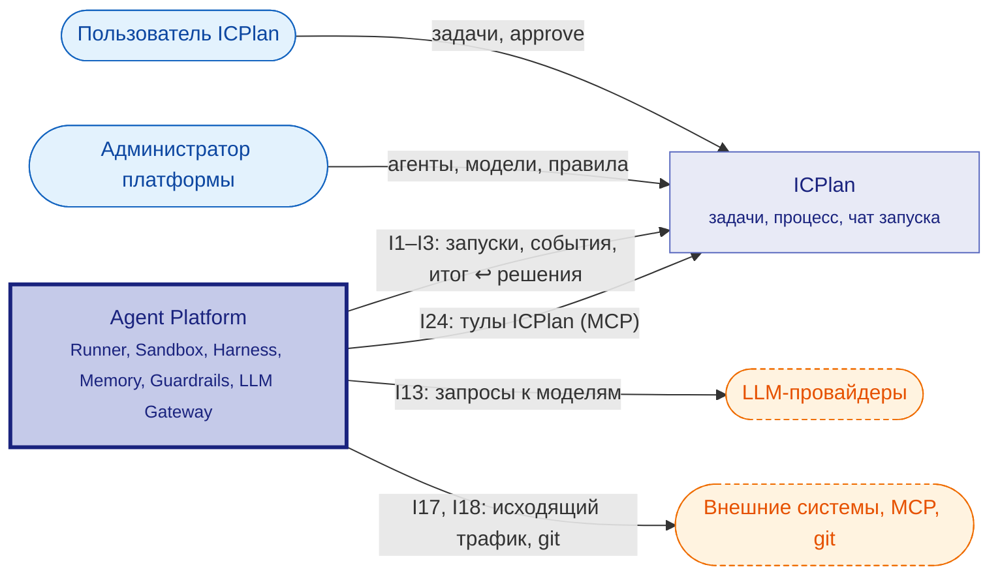
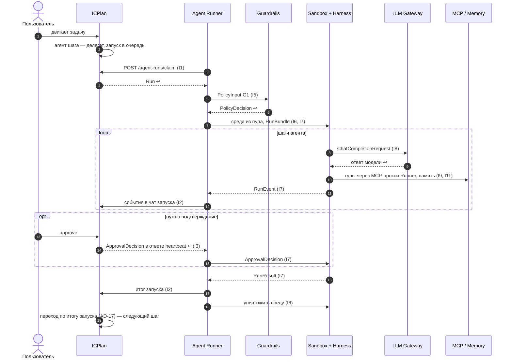
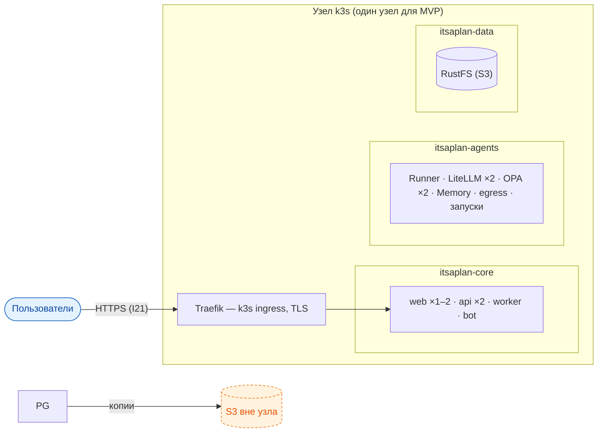

# Агентная архитектура (v0.9)

Модель C4: **C1** — наша система (Agent Platform) и её связь с [ICPlan](../architecture/components/icplan/README.md) и внешним миром (ниже). **C2** — карта платформы выше: компоненты и связи между ними. Устройство каждого компонента (C3) — на его вкладке «Архитектура». Схемы — по FORMAT.md.

## C1 — System Context

Интеграция с [ICPlan](../architecture/components/icplan/README.md): [Agent Runner](../architecture/components/agent-runner/README.md) — внешний раннер [ICPlan](../architecture/components/icplan/README.md) (забирает запуски, шлёт события и итог, получает решения пользователя в ответе heartbeat). Стыки каждого компонента — вкладка «Интеграции», типы данных и матрица интерфейсов — [Справка](data-types.md).

## Взаимодействие компонентов {#interaction}

Сквозной поток MVP: пользователь двигает задачу — агент выполняет — итог возвращается в задачу. Правило оформления — «Порядок работы и сценарии»; порядок работы каждого компонента — раздел «Как работает» на его вкладке «Архитектура».

### Порядок работы и сценарии

#### Порядок работы

| # | Шаг | Участники | Данные | I | Сценарий |
|---|---|---|---|---|---|
| 1 | Задача вошла в шаг процесса с агентом | [ICPlan](../architecture/components/icplan/README.md) → [ICPlan](../architecture/components/icplan/README.md) | `delegateUserId` задачи | — | С1 |
| 2 | Запуск в очередь | [ICPlan](../architecture/components/icplan/README.md) → БД [ICPlan](../architecture/components/icplan/README.md) | [`Run`](../architecture/data/model-Run.yaml) (pending) | — | С1 |
| 3 | Runner забирает запуск | [Agent Runner](../architecture/components/agent-runner/README.md) → [ICPlan](../architecture/components/icplan/README.md) | [`Run`](../architecture/data/model-Run.yaml) | [I1](../architecture/components/agent-runner/integrations/I1.yaml) | С1 |
| 4 | Допуск и бюджет (G1) | [Agent Runner](../architecture/components/agent-runner/README.md) → [Guardrails](../architecture/components/guardrails/README.md) | [`PolicyInput`](../architecture/data/model-PolicyInput.yaml) → [`PolicyDecision`](../architecture/data/model-PolicyDecision.yaml) | [I5](../architecture/components/agent-runner/integrations/I5.yaml) | С1 |
| 5 | Среда и задание | [Agent Runner](../architecture/components/agent-runner/README.md) → [Sandbox](../architecture/components/sandbox/README.md), [Harness](../architecture/components/harness/README.md) | [`SandboxClaim`](../architecture/data/model-SandboxClaim.yaml), [`RunBundle`](../architecture/data/model-RunBundle.yaml) | [I6](../architecture/components/agent-runner/integrations/I6.yaml), [I7](../architecture/components/agent-runner/integrations/I7.yaml) | С1 |
| 6 | Вызов модели | [Harness](../architecture/components/harness/README.md) → LLM Gateway | [`ChatCompletionRequest`](../architecture/data/model-ChatCompletionRequest.yaml) | [I8](../architecture/components/harness/integrations/I8.yaml) | С1 |
| 7 | Действия и память | [Harness](../architecture/components/harness/README.md) → MCP-прокси Runner → MCP; [Harness](../architecture/components/harness/README.md) → [Memory](../architecture/components/memory/README.md) | [`McpToolCall`](../architecture/data/model-McpToolCall.yaml), [`M3Record`](../architecture/data/model-M3Record.yaml) | [I9](../architecture/components/harness/integrations/I9.yaml), [I11](../architecture/components/harness/integrations/I11.yaml) | С1 |
| 8 | Шаги работы | [Harness](../architecture/components/harness/README.md) → [Agent Runner](../architecture/components/agent-runner/README.md) → [ICPlan](../architecture/components/icplan/README.md) | [`RunEvent`](../architecture/data/model-RunEvent.yaml) | [I7](../architecture/components/agent-runner/integrations/I7.yaml), [I2](../architecture/components/agent-runner/integrations/I2.yaml) | С1 |
| 9 | Подтверждение | [ICPlan](../architecture/components/icplan/README.md) → [Agent Runner](../architecture/components/agent-runner/README.md) → [Harness](../architecture/components/harness/README.md) | [`ApprovalDecision`](../architecture/data/model-ApprovalDecision.yaml) | [I3](../architecture/components/agent-runner/integrations/I3.yaml), [I7](../architecture/components/agent-runner/integrations/I7.yaml) | С1 |
| 10 | Итог | [Harness](../architecture/components/harness/README.md) → [Agent Runner](../architecture/components/agent-runner/README.md) → [ICPlan](../architecture/components/icplan/README.md) | [`RunResult`](../architecture/data/model-RunResult.yaml) | [I7](../architecture/components/agent-runner/integrations/I7.yaml), [I2](../architecture/components/agent-runner/integrations/I2.yaml) | С1 |
| 11 | Уничтожение среды | [Agent Runner](../architecture/components/agent-runner/README.md) → [Sandbox](../architecture/components/sandbox/README.md) | `sandboxId` | [I6](../architecture/components/agent-runner/integrations/I6.yaml) | С1 |
| 12 | Переход задачи по итогу запуска — следующий шаг процесса (снова 1) | [ICPlan](../architecture/components/icplan/README.md) → [ICPlan](../architecture/components/icplan/README.md) | `process_step.on_success / on_failure` | — | С1 |

#### С1. Сквозной поток MVP

## Развёртывание (C4 deployment)

Ресурсы узла и профиль нагрузки — [R&D: профиль нагрузки](..\research\load-profile.md), разделы «Нагрузка и производительность» спек. Подробно: спека platform-infrastructure и [схема](..\architecture\components\infrastructure\docs\platform-infrastructure-architecture.md). Технологии — [сводная таблица](TECHNOLOGIES.md). Обоснование: [Kubernetes](..\research\kubernetes-runtime.md) · [ingress](..\research\ingress-and-balancing.md) · [СУБД и хранилища](..\research\data-stores.md) · [design AD-15, AD-16](design\define-agent-platform\design.md).

## Сквозные решения

Что выбрано — одной фразой; почему и подробности — в решении (design) и на странице компонента (правило).

| Решение | Что выбрано | D | Подробно |
|---|---|---|---|
| Агентский цикл | [Harness](../architecture/components/harness/README.md) на LangGraph внутри sandbox: модель «думает», остальное — [Harness](../architecture/components/harness/README.md) | [AD-2](../architecture/decisions/AD-2.yaml) | [Harness](../architecture/components/harness/README.md) |
| [Guardrails](../architecture/components/guardrails/README.md) | четыре точки: G1, G2 видят смысл (OPA), G3, G4 не обойти; Rego в git, данные в [Platform module](../architecture/components/platform-module/README.md) | [AD-6](../architecture/decisions/AD-6.yaml), [AD-19](../architecture/decisions/AD-19.yaml) | [Guardrails](../architecture/components/guardrails/README.md) |
| Очередь и планирование | очередь в [ICPlan](../architecture/components/icplan/README.md); Runner стартует запуск, когда свободны все слоты | [AD-14](../architecture/decisions/AD-14.yaml) | [Agent Runner](../architecture/components/agent-runner/README.md) |
| Исполнение | тёплый пул + одноразовый контейнер на запуск | [AD-1](../architecture/decisions/AD-1.yaml) | [Sandbox](../architecture/components/sandbox/README.md) |
| Память | уровни M0–M6, область видимости — атрибут записи; M3 — [Memory](../architecture/components/memory/README.md) API | [AD-4](../architecture/decisions/AD-4.yaml), [AD-20](../architecture/decisions/AD-20.yaml) | [Memory](../architecture/components/memory/README.md) |
| RAG | не в MVP: документы — `get_document`, код — агентный поиск | [AD-13](../architecture/decisions/AD-13.yaml) | [Memory](../architecture/components/memory/README.md) |
| Хранение конфигурации | определения — БД [ICPlan](../architecture/components/icplan/README.md); наши настройки — [Platform module](../architecture/components/platform-module/README.md); Runner получает определение и настройки одной версии у [Platform module](../architecture/components/platform-module/README.md); экраны — у объекта настройки; Rego — git; перенос — YAML | [AD-9](../architecture/decisions/AD-9.yaml), [AD-23](../architecture/decisions/AD-23.yaml), [AD-24](../architecture/decisions/AD-24.yaml) | [Platform module](../architecture/components/platform-module/README.md) |
| MCP или прямой вызов | правила R1–R7; агент ходит к MCP только через MCP-прокси Runner | [AD-10](../architecture/decisions/AD-10.yaml), [AD-19](../architecture/decisions/AD-19.yaml) | [MCP / Tools](../architecture/components/mcp-tools/README.md) |
| Рабочие данные | `/workspace` исчезает со средой; код — ветка и PR; документы — в задачу | [AD-11](../architecture/decisions/AD-11.yaml) | [Sandbox](../architecture/components/sandbox/README.md) |
| [Observability](../architecture/components/observability/README.md) | события пишутся всегда в формате AG-UI, показываются в задаче чатом запуска | [AD-12](../architecture/decisions/AD-12.yaml), [AD-18](../architecture/decisions/AD-18.yaml), [AD-21](../architecture/decisions/AD-21.yaml) | [Observability](../architecture/components/observability/README.md) |
| Ход задачи | процесс задачи: шаг = колонка + агент, переход делает [ICPlan](../architecture/components/icplan/README.md) по итогу | [AD-17](../architecture/decisions/AD-17.yaml) | [ICPlan](../architecture/components/icplan/README.md) |
| Сроки хранения | срок памяти — фильтр чтения [Memory](../architecture/components/memory/README.md); запуски и переписку удаляет владелец таблиц, [ICPlan](../architecture/components/icplan/README.md); журнал задачи живёт с задачей | [AD-22](../architecture/decisions/AD-22.yaml), [AD-25](../architecture/decisions/AD-25.yaml) | [ICPlan](../architecture/components/icplan/README.md) |
